# InSync — Flutter Application Documentation

> **Scope.** This document describes the code as it exists in `lib/` at commit `47757f2`. It was verified on 2026-11-19, including a run on the Android emulator. It documents only what is implemented. When something was checked and not found, the section says so in one line. Items whose intent can't be determined from the code are marked **Needs Further Investigation**.

## Contents

1. [Project at a glance](#1-project-at-a-glance)
2. [Project architecture](#2-project-architecture)
3. [Screens and widgets](#3-screens-and-widgets)
4. [State management](#4-state-management)
5. [Navigation](#5-navigation)
6. [API and networking](#6-api-and-networking)
7. [Data models and data flow](#7-data-models-and-data-flow)
8. [Mobile-specific functionality](#8-mobile-specific-functionality)
9. [Dependencies](#9-dependencies)
10. [UI and design system](#10-ui-and-design-system)
11. [Application lifecycle](#11-application-lifecycle)
12. [Observed behaviour and open questions](#12-observed-behaviour-and-open-questions)

---

## 1. Project at a glance

| Item | Value |
|---|---|
| Package name | `insync` (`pubspec.yaml`) |
| Dart SDK constraint | `^3.13.4` (uses dot-shorthand syntax such as `.light`, `.new(...)`, `.symmetric(...)`) |
| App type | Client-only UI prototype. There is no backend integration yet. |
| Entry point | `lib/main.dart` → `main()` → `runApp(MyApp())` |
| Root widget | `MyApp` (`StatelessWidget`) returning a `MaterialApp` |
| First screen | `OnboardingScreen` |
| Data source | Hard-coded sample data from `getSampleTickets()` in `lib/screens/my_ticket_screen.dart` |
| Persisted state | One integer key, `tab_index`, in `SharedPreferences` |
| Size | 29 Dart files, about 3,000 lines |

---

## 2. Project architecture

### 2.1 `lib/` folder structure

```
lib/
├── main.dart                     App entry point, MaterialApp, light/dark ThemeData
├── colors.dart                   InSyncColors palette + AdaptiveColors + blend-filter widgets
├── utils.dart                    WeekdayOptions enum + getWeekDay() (marked "// TODO: Delete")
├── widget_lib/
│   └── notched_circle.dart       ClipNotchedCircle (CustomClipper used by ProfileStack)
├── model/
│   ├── project.dart              Project (name, description)
│   ├── ticket.dart               Ticket + Priority enum
│   └── user.dart                 User (userId, name)
├── screens/
│   ├── auth/
│   │   ├── auth_navigation.dart  enterApp(): leaves auth flow → StartPage
│   │   ├── onboarding_screen.dart
│   │   ├── create_org_screen.dart
│   │   ├── join_org_screen.dart
│   │   ├── sign_up_screen.dart
│   │   └── login_screen.dart
│   ├── start_page.dart           Tab shell (bottom nav + tab body)
│   ├── home_screen.dart          "Home" tab
│   ├── my_ticket_screen.dart     "My Tickets" tab + getSampleTickets()
│   ├── placeholder_page.dart     "Search" tab ("Page is under construction")
│   └── ticket_detail.dart        Ticket detail page
└── widgets/
    ├── auth/auth_components.dart AuthScaffold, AuthTitle, AuthSubtitle, AuthTextField, AuthButton
    ├── common/
    │   ├── app_bar.dart          InSyncAppBar (incl. DEBUG menu)
    │   └── bottom_nav_bar.dart   AppNavBar (Liquid Glass or Material NavigationBar)
    ├── tickets/
    │   ├── Sorting_Tickets.dart  TicketSorting (sort + group by priority)
    │   ├── buildSection.dart     BuildSection (titled InSyncList)
    │   ├── tag.dart              Tag (pill label)
    │   └── ticket_Builder.dart   TicketListItemBuilder (Ticket → InSyncListItem)
    ├── InSync_list.dart          InSyncList, InSyncListItem, ListChevronAccessory, getTickets()
    ├── calendar_carousel.dart    CalendarCarousel (horizontal day picker)
    ├── contribution_card.dart    ContributionCard ("Closed N Tickets in the last 7 Days")
    └── profile_stack.dart        ProfileStack (overlapping avatar row + "+N" bubble)
```

Assets: `assets/images/logo.png`, `assets/images/logo_sync.svg` and four placeholder avatars (`placeholder_narcissist.png`, `_2`, `_3`, `_4`). Fonts: `Inter` and `SF-Pro-Rounded`, declared in `pubspec.yaml` and stored under `assets/fonts/`.

### 2.2 Entry point and root widget

```dart
// lib/main.dart
void main() {
  runApp(MyApp());
}
```

- `main()` does nothing before `runApp()`. It doesn't call `WidgetsFlutterBinding.ensureInitialized()`, set up dependency injection, or load any async configuration.
- `MyApp` is a `StatelessWidget` that returns a single `MaterialApp`:
  - `debugShowCheckedModeBanner: false`
  - `theme` / `darkTheme`: two `ThemeData` objects built from `InSyncColors` (see [§10](#10-ui-and-design-system)). `themeMode` isn't set, so it defaults to `ThemeMode.system` and follows the device setting.
  - `navigatorObservers: [LiquidGlassNavigatorObserver()]`, from `native_liquid_glass`. It lets that package track route changes for its native glass components.
  - `home: const OnboardingScreen()`. There are no `routes`, no `onGenerateRoute` and no router package.

The app uses `MaterialApp` only. There is no `CupertinoApp`, although individual widgets use Cupertino icons and native iOS components when they're supported.

### 2.3 Architecture pattern

**No formal architecture pattern is implemented.** There is no Clean Architecture, MVC, MVVM, BLoC, Provider, GetX or Riverpod. In practice the code is organized as **layered by folder: `model/` → `widgets/` → `screens/`**:

| Layer | What lives there | How it's actually used |
|---|---|---|
| `model/` | Plain mutable Dart classes (`Ticket`, `Project`, `User`) and the `Priority` enum | Constructed directly in `getSampleTickets()`. They have no serialization and no business methods apart from `Priority.priorityText` and `getPriorityColor()`. |
| `widgets/` | Reusable UI plus small helpers (`TicketSorting`, `TicketListItemBuilder`) | Screens call the helpers directly. |
| `screens/` | Pages | Hold their own state in `State` objects or in file-level globals, and create their own data. |

There is no service, repository or controller layer. Screens get data by calling `getSampleTickets()` directly.

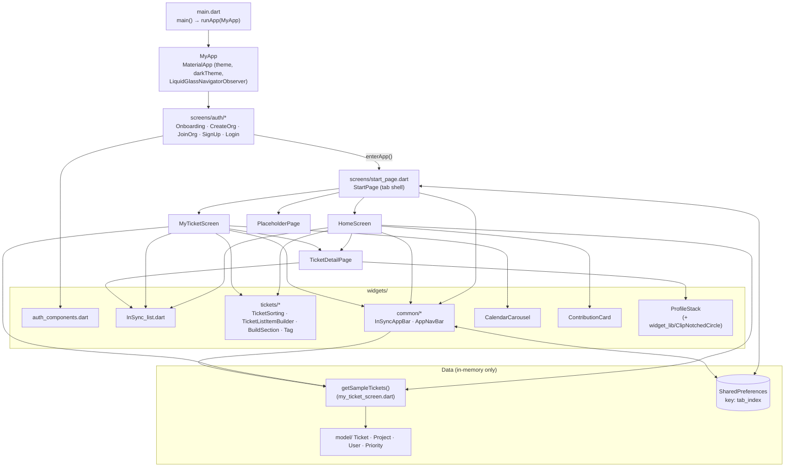

---

## 3. Screens and widgets

### 3.1 Screen inventory

| Screen | File | Type | Receives | Shows |
|---|---|---|---|---|
| `OnboardingScreen` | `screens/auth/onboarding_screen.dart` | Stateless | — | Title "InSync", lorem-ipsum subtitle, **Sign up** and **Log in** buttons |
| `CreateOrgScreen` | `screens/auth/create_org_screen.dart` | Stateful | — | Org-name field, **Next**, **Join an org** |
| `JoinOrgScreen` | `screens/auth/join_org_screen.dart` | Stateful | — | Org-code field (`XXXX-XXXX-XXXX-XXXX`), **Next**, **Create an org** |
| `SignUpScreen` | `screens/auth/sign_up_screen.dart` | Stateful | `organizationName?`, `organizationCode?` (constructor) | Display name, email and password fields, **Sign up** |
| `LoginScreen` | `screens/auth/login_screen.dart` | Stateful | — | Email and password fields, **Log in** |
| `StartPage` | `screens/start_page.dart` | Stateful | — | The current tab body plus `AppNavBar` |
| `HomeScreen` | `screens/home_screen.dart` | Stateless | — | `ContributionCard`, "Priority Tickets" (first 3 sample tickets), "My Projects" (3 hard-coded rows) |
| `MyTicketScreen` | `screens/my_ticket_screen.dart` | Stateful | — | `CalendarCarousel`, "Tickets Due" with a sort menu, and the ticket list (flat or grouped by priority) |
| `PlaceholderPage` | `screens/placeholder_page.dart` | Stateless | — | Hammer icon and "Page is under construction" (used as the **Search** tab) |
| `TicketDetailPage` | `screens/ticket_detail.dart` | Stateful | `Ticket ticket` (required, constructor) | Project row, due date, assigned by, assigned to (`ProfileStack` of 9 hard-coded images), description, last modified |

All data is passed between screens **through constructor arguments**. No `RouteSettings.arguments` are used.

`SignUpScreen` accepts `organizationName` / `organizationCode`, but it doesn't currently read or display them. It only stores them as fields.

### 3.2 Auth screens

All five auth screens share one layout, `AuthScaffold`, and pass their content in as `children`.

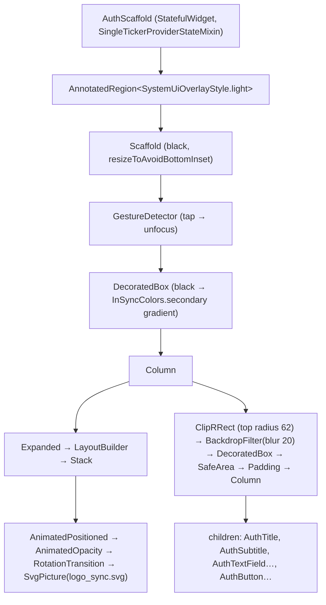

Lifecycle and controllers:

| Class | Controllers / resources | `initState` | `dispose` |
|---|---|---|---|
| `_AuthScaffoldState` | `AnimationController _spin` (1998 ms, `repeat(reverse: true)`) and `Animation<double> _turns` (0 → 1/6 turn, `Interval(0, 0.75, easeOutBack)`) | None. Both are `late final` and created on first access. | `_spin.dispose()` |
| `_CreateOrgScreenState` | `TextEditingController _orgName` | — | disposes `_orgName` |
| `_JoinOrgScreenState` | `TextEditingController _code` | — | disposes `_code` |
| `_SignUpScreenState` | `_displayName`, `_email`, `_password` controllers | — | disposes all three |
| `_LoginScreenState` | `_email`, `_password` controllers | — | disposes both |

`AuthScaffold` also responds to the keyboard. When `MediaQuery.viewInsets.bottom > 0`, the logo animates to the top and shrinks to a maximum of 200 px. It fades out below 40 px.

No `FocusNode`s or `GlobalKey`s are declared anywhere in the project. Field-to-field focus relies on `TextInputAction.next`, and tapping outside a field calls `FocusScope.of(context).unfocus()`.

### 3.3 Main app shell: `StartPage`

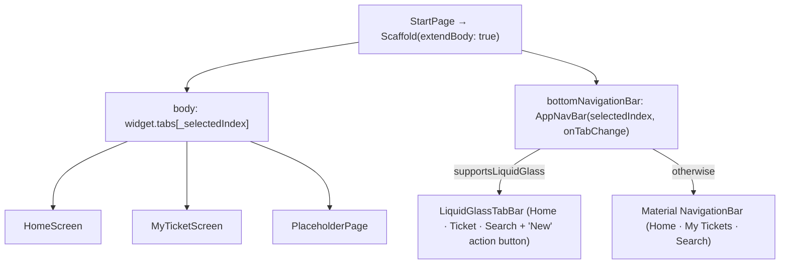

- `tabs` is a non-final instance field on the `StartPage` widget: `[HomeScreen(), MyTicketScreen(), PlaceholderPage()]`.
- The selected tab is stored in a **file-level global**, `int _selectedIndex = 0`. It is not a field of `_StartPageState`.
- On construction, and again in `initState`, `StartPage` reads `SharedPreferences.getInt("tab_index")` and overwrites `_selectedIndex` when a value exists. `initState` calls `setState`.
- Switching tabs replaces the body widget. There's no `IndexedStack`, so each tab's `State` is rebuilt when you switch to it.
- A commented-out nested `Navigator` carries a `// TODO: Resolve Navigator issue` note.

### 3.4 `HomeScreen`

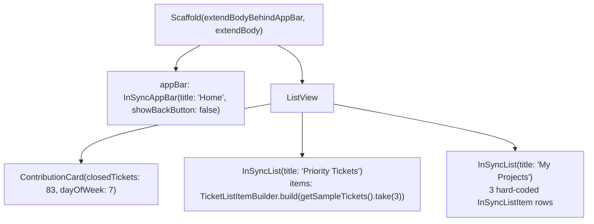

- The values `83` and `7` are hard-coded.
- "Priority Tickets" shows the **first three** sample tickets in list order. It doesn't filter or sort by priority.
- "My Projects" rows ("Dog Feeding" / "Cat Feeding" / "Chicken Feeding") have no `onTap`.

### 3.5 `MyTicketScreen`

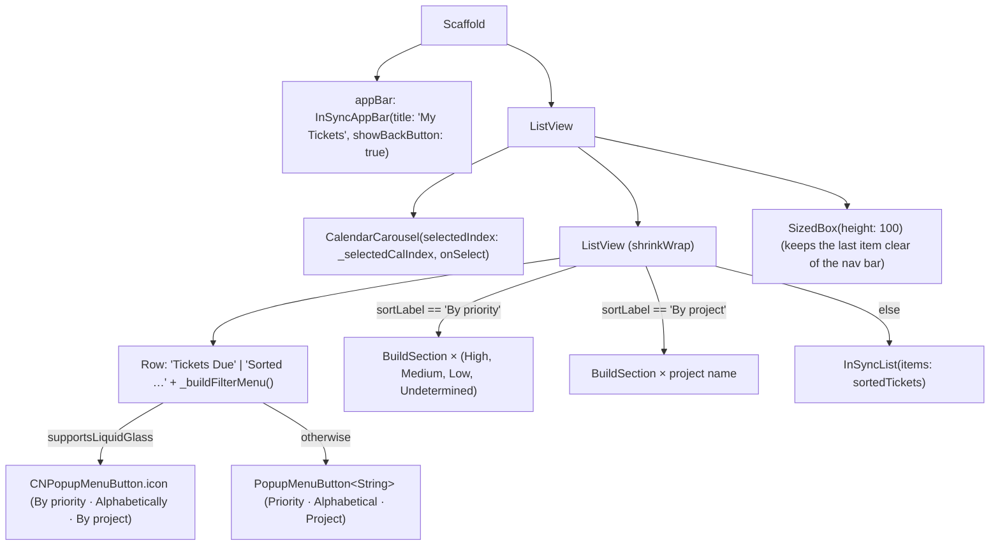

- State: `late final List<Ticket> tickets = getSampleTickets()` (instance field). `sortLabel` and `_selectedCalIndex` are **file-level globals**, so their values survive tab switches.
- `build()` sorts on every rebuild with `TicketSorting.sortTickets(tickets, sortLabel)`, then calls both `TicketSorting.groupByPriority(...)` and `TicketSorting.groupByProjectName(...)`. Which result is shown depends on `sortLabel`: `'By priority'` shows priority sections, `'By project'` shows one section per project in first-seen order, and anything else shows one flat list.
- In `CalendarCarousel.onSelect`, the screen assigns `_selectedCalIndex` without calling `setState`. The selected date **doesn't filter the tickets**.
- See [§12](#12-observed-behaviour-and-open-questions) for a mismatch between the sort-label strings.

### 3.6 `TicketDetailPage`

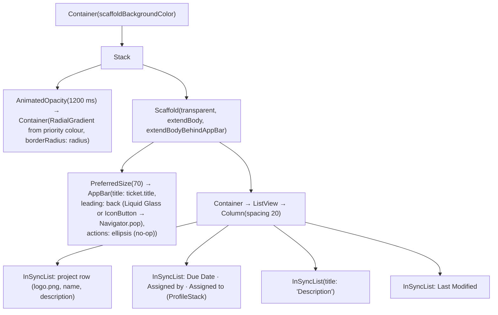

Lifecycle:
- `initState`: adds the `_handleDrawerExtentChange` listener to `_drawerController` (a `DraggableScrollableController`). It also schedules `opacity = 1` after 1 µs **without calling `setState`**.
- `build`: calls `computeDisplayBorderRadius()` on **every build**. That method calls `DeviceInfoPlugin().iosInfo` and, when the result comes back, sets `radius` from the iPhone model name and calls `setState`.
- `dispose`: removes the listener and disposes `_drawerController`.
- The bottom sheet (`DraggableScrollableSheet`) that uses `_drawerController` and `_drawerVisible` is **commented out**. The controller and its listener are created but nothing is attached to them.

### 3.7 Reusable custom widgets

| Widget | File | Purpose / API |
|---|---|---|
| `AuthScaffold` | `widgets/auth/auth_components.dart` | Shared auth layout: animated rotating logo plus a frosted bottom panel. Params: `children`, `logoOverlap` (default 30), `panelOpacity` (default 0.15). |
| `AuthTitle` / `AuthSubtitle` | same | Text styles: 40 pt bold with a shadow, and 16 pt white. |
| `AuthTextField` | same | 45 px glass-pill `TextField`. Params: `hint`, `controller`, `obscureText`, `keyboardType`, `textInputAction`, `autofillHints`, `onSubmitted`. |
| `AuthButton` + `AuthButtonStyle {primary, secondary}` | same | Pill button. Primary is orange; secondary is the glass pill. `height` defaults to 45 (60 on onboarding). |
| `InSyncAppBar` | `widgets/common/app_bar.dart` | `StatefulWidget` implementing `PreferredSizeWidget` (height 65). Bold 26 pt title, a settings button (no-op), and a **DEBUG** menu shown when `debugProperties` is true, which is the default. See [§5](#5-navigation). |
| `AppNavBar` | `widgets/common/bottom_nav_bar.dart` | Bottom tabs. Uses `LiquidGlassTabBar` when `NativeLiquidGlassUtils.supportsLiquidGlass`, otherwise a Material `NavigationBar`. Params: `selectedIndex`, `onTabChange`. |
| `InSyncList` | `widgets/InSync_list.dart` | Grouped inset list (iOS-settings style, radius 26) with an optional `title` and `isLoading` (shows a spinner). Rounds the first and last rows, puts dividers between rows, and wraps a row in an `InkResponse` (sparkle splash) when that row has `onTap`. |
| `InSyncListItem` | same | Row with optional `title`, `subtext`, `boldTitle`, `leadingAccessory`, `trailingAccessory`, `bottomAccessory`, `padding`, `spacing`, `onTap`. |
| `ListChevronAccessory` | same | Trailing chevron drawn through `ExclusionFilter`. |
| `Tag` | `widgets/tickets/tag.dart` | Small pill label (`text`, `backgroundColor`, `textColor`). |
| `BuildSection` | `widgets/tickets/buildSection.dart` | A titled `InSyncList` with bottom padding, used for each priority group. |
| `TicketListItemBuilder.build` | `widgets/tickets/ticket_Builder.dart` | Static: `List<Ticket>` → `List<InSyncListItem>`. Each row has the logo, title, tags (project, "Due in Nd", priority) and a chevron. `onTap` pushes `TicketDetailPage`. |
| `TicketSorting` | `widgets/tickets/Sorting_Tickets.dart` | Static `sortTickets(tickets, sortType)` (matches `'by Priority'`, `'Alphabetically'`, `'by Project'`), `groupByPriority(tickets)` and `groupByProjectName(tickets)` (a `Map<String, List<Ticket>>` keyed by project name, in first-seen order). |
| `CalendarCarousel` | `widgets/calendar_carousel.dart` | Infinite horizontal day strip starting today. Tapping a day toggles selection (`onSelect` / `onDeselect`), and a red divider with the month or year label marks the 1st of each month. Selection is stored by **mutating `widget.selectedIndex`**, then `setState`. |
| `ContributionCard` | `widgets/contribution_card.dart` | Orange card reading "Closed {closedTickets} Tickets in the last", with a calendar-page graphic showing `{dayOfWeek}` "Days". |
| `ProfileStack` | `widgets/profile_stack.dart` | 120 × 30 row of overlapping 30 px avatars. It always takes `children.sublist(0, 5)`: child 0 is a full circle, children 1–3 are clipped by `ClipNotchedCircle` (a circle with a notch cut where the previous avatar overlaps), and the 5th slot is replaced by a "+{children.length − 4}" bubble. Offsets are 22 px apart. |
| `ClipNotchedCircle` | `widget_lib/notched_circle.dart` | `CustomClipper<Path>`: the widget's circle minus an offset circle on its left, giving the "notch". |
| `ExclusionFilter` / `ColorDodgeFilter` | `colors.dart` | `Widget` subclasses whose `createElement()` returns a `BackdropFilter` with `exclusion` or `colorDodge` blend and blur. Used to reproduce the mockup's blend modes on chevrons and dividers. |
| `PlaceholderPage` | `screens/placeholder_page.dart` | Generic "under construction" page. |

`getTickets(BuildContext)` in `InSync_list.dart` returns two hard-coded `InSyncListItem`s but **is not referenced anywhere**.

---

## 4. State management

**No state-management package is used.** All state is handled with Flutter's built-in mechanisms:

| Mechanism | Where | What it holds |
|---|---|---|
| `StatefulWidget` + `setState` | `_StartPageState`, `_MyTicketScreenState`, `_CalendarCarouselState`, `InSyncAppBarState`, `TicketDetailPageState` | Selected tab, sort choice, calendar selection, DEBUG-menu checkmark, border radius |
| File-level mutable globals | `start_page.dart` → `_selectedIndex`; `my_ticket_screen.dart` → `sortLabel`, `_selectedCalIndex` | Values that outlive the widget's `State` (kept across tab switches, which rebuild tab `State`s) |
| Mutable widget fields | `CalendarCarousel.selectedIndex`, `AppNavBar.selectedIndex`/`onTabChange`, `ContributionCard` fields, `StartPage.tabs` | Not `final`, so the widget is mutated directly in some cases |
| `TextEditingController` | Auth screens | Form input (read only in `CreateOrgScreen` and `JoinOrgScreen` to pass on to `SignUpScreen`) |
| `AnimationController` | `AuthScaffold` | Logo rotation |
| `SharedPreferences` | `StartPage`, `InSyncAppBar` | `tab_index` (see [§8](#8-mobile-specific-functionality)) |

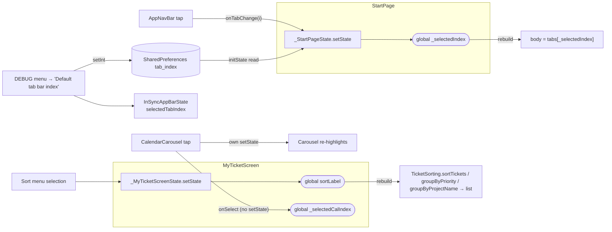

**Loading and error states:** `InSyncList` has an `isLoading` flag that swaps in `LiquidGlassActivityIndicator` or `CircularProgressIndicator`, but no caller sets it to `true`. There is no error-state handling anywhere in the UI.

---

## 5. Navigation

Navigation uses the imperative **Navigator 1.0** API with `MaterialPageRoute` throughout. There are **no named routes, no `onGenerateRoute`, no GoRouter/AutoRoute and no route guards**. The commented-out `Navigator.pushNamed(context, "ticket_detail")` calls in `app_bar.dart` and the nested `Navigator` in `start_page.dart` are disabled (`// TODO: Resolve Navigator issue`).

### 5.1 Navigation calls

| From | Trigger | Call | To | Arguments |
|---|---|---|---|---|
| `OnboardingScreen` | **Sign up** | `push` | `CreateOrgScreen` | — |
| `OnboardingScreen` | **Log in** | `push` | `LoginScreen` | — |
| `CreateOrgScreen` | **Next** / keyboard submit | `push` | `SignUpScreen` | `organizationName: _orgName.text.trim()` |
| `CreateOrgScreen` | **Join an org** | `pushReplacement` | `JoinOrgScreen` | — |
| `JoinOrgScreen` | **Next** / keyboard submit | `push` | `SignUpScreen` | `organizationCode: _code.text.trim()` |
| `JoinOrgScreen` | **Create an org** | `pushReplacement` | `CreateOrgScreen` | — |
| `SignUpScreen` | **Sign up** / submit | `enterApp(context)` → `pushAndRemoveUntil(…, (_) => false)` | `StartPage` | — |
| `LoginScreen` | **Log in** / submit | `enterApp(context)` → `pushAndRemoveUntil` | `StartPage` | — |
| `StartPage` | Tab bar | `setState` swaps `body` (no route) | `HomeScreen` / `MyTicketScreen` / `PlaceholderPage` | — |
| `HomeScreen`, `MyTicketScreen` | Tap a ticket row | `push` (in `TicketListItemBuilder`) | `TicketDetailPage` | `ticket: ticket` |
| `InSyncAppBar` | DEBUG → "Show sample ticket" / "Sample Ticket" | `push` | `TicketDetailPage` | `ticket: getSampleTickets()[0]` |
| `TicketDetailPage` | Back button | `Navigator.pop(context)` | previous route | — |

`enterApp()` (`screens/auth/auth_navigation.dart`) clears the whole stack, so the back button can't return to the auth flow after sign up or log in.

**Auth guard:** none. `SignUpScreen._signUp()` and `LoginScreen._logIn()` call `enterApp` without checking the fields (`// TODO: Authenticate against the backend once it exists.`). The app always starts at `OnboardingScreen`.

### 5.2 Navigation diagram

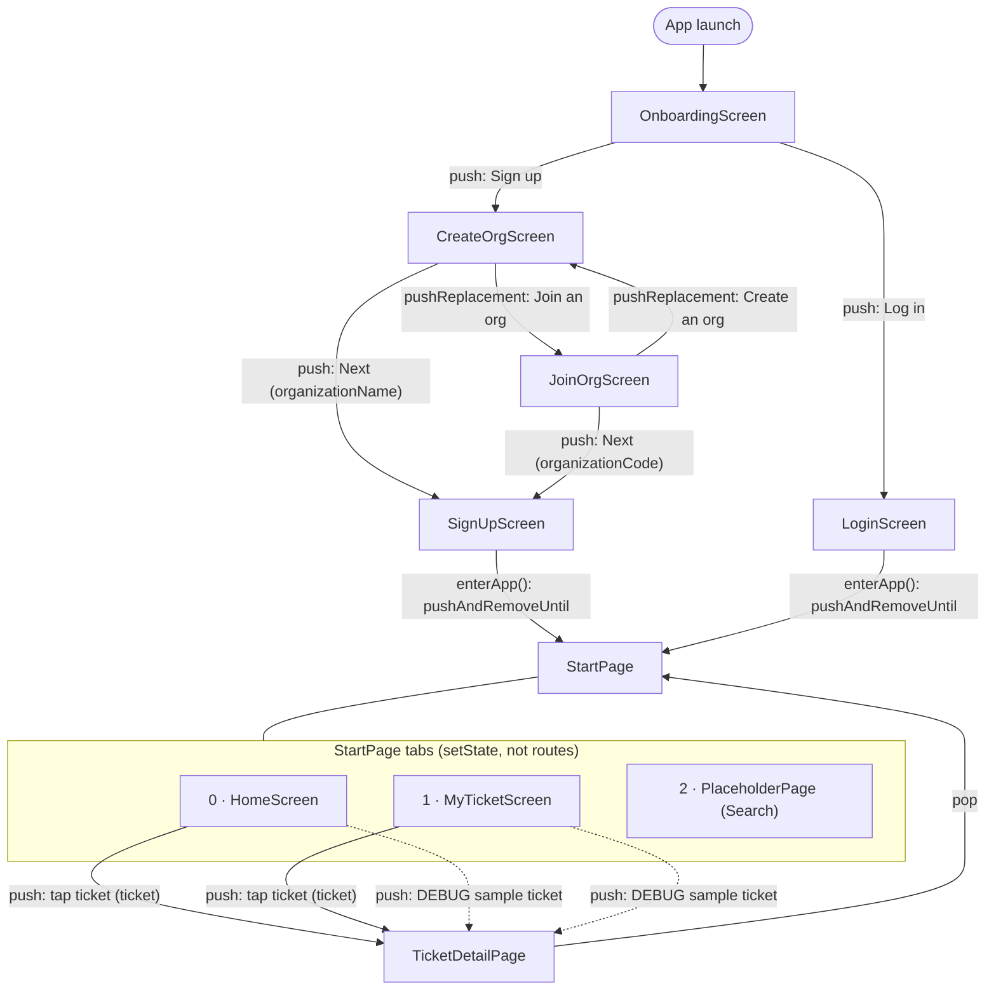

---

## 6. API and networking

**No networking is implemented.** `http: ^1.6.0` is declared in `pubspec.yaml`, but nothing in `lib/` imports it. There are no API clients, base URLs, interceptors, tokens, repositories, JSON (de)serialization or uploads. The two places that would call a backend are marked with TODOs:

- `lib/screens/auth/login_screen.dart`: `// TODO: Authenticate against the backend once it exists.`
- `lib/screens/auth/sign_up_screen.dart`: `// TODO: Create the account (and org / join via code) once the backend exists.`

Because there is no API, the "API request lifecycle" diagram from the brief is omitted. The real data flows are traced in §7.

---

## 7. Data models and data flow

### 7.1 Models

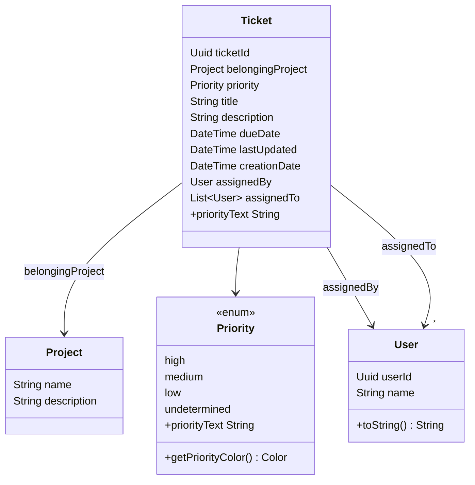

- `ticketId` and `userId` are typed as `Uuid`, the **generator class** from `package:uuid`, not a `String` ID. `getSampleTickets()` passes `Uuid()` (a new generator instance), so no actual UUID string is ever generated or stored.
- None of the models has `fromJson` / `toJson`, `==`, or `copyWith`.
- `Priority.getPriorityColor()` returns Material `Colors.red` / `yellow` / `green` / `grey`. It does **not** use the `InSyncColors.highPriority` / `mediumPriority` / `lowPriority` values.

### 7.2 Sample data

`getSampleTickets()` (`lib/screens/my_ticket_screen.dart:184`) builds six tickets across three projects (`InSync`, `SpendWise`, `Elevate`) and two users (`Shimaa`, `Ahmed`), with due dates of today + 1, 2, 5, 7, 10 and 14 days. It's called from:

- `HomeScreen.build` (`.take(3)`)
- `_MyTicketScreenState.tickets` (once per `State`)
- `InSyncAppBar`'s DEBUG menu (`[0]`)

### 7.3 Feature call flows

These are the actual flows. There's no repository or API step, because none exists.

**A. Sign-up via "Create an org"**

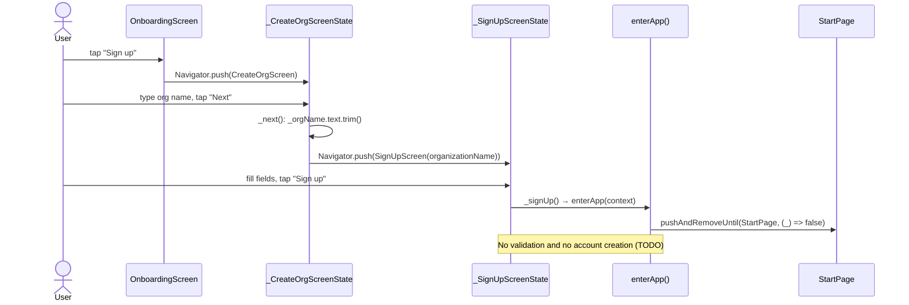

**B. Log in**

`LoginScreen` → **Log in** tap or password-field submit → `_LoginScreenState._logIn()` → `enterApp(context)` → `StartPage`. The email and password controllers are never read.

**C. Tab switching and restoring the saved tab**

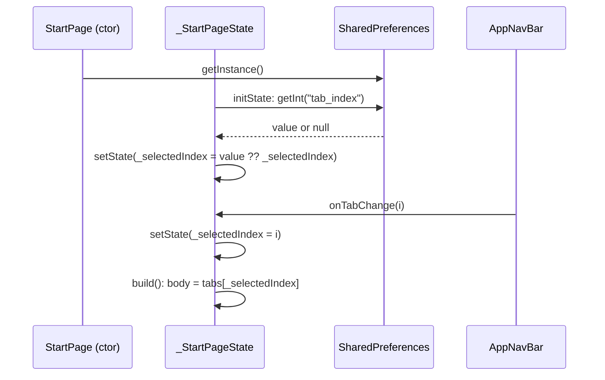

**D. Sorting tickets on My Tickets**

`_buildFilterMenu` selection → `setState(sortLabel = …)` → `build()` → `TicketSorting.sortTickets(tickets, sortLabel)` → `TicketSorting.groupByPriority(sorted)` and `TicketSorting.groupByProjectName(sorted)` → if `sortLabel == 'By priority'`, one `BuildSection` per non-empty `High`/`Medium`/`Low`/`Undetermined` group; if `sortLabel == 'By project'`, one `BuildSection` per project; otherwise a single `InSyncList` → `TicketListItemBuilder.build` → `InSyncListItem`s. The per-option results, which differ between iOS and Android, are in [§12](#12-observed-behaviour-and-open-questions) item 2.

**E. Opening a ticket**

Tap a row → `InSyncListItem.onTap` (wired by `TicketListItemBuilder`) → `InSyncList`'s `InkResponse.onTap` → `Navigator.push(TicketDetailPage(ticket: ticket))` → `TicketDetailPageState.build` reads `widget.ticket` fields and calls `computeDisplayBorderRadius()` → `DeviceInfoPlugin().iosInfo` → `setState` → rebuild.

**F. DEBUG: setting the default tab**

`InSyncAppBar` (Liquid Glass branch only) → `LiquidGlassMenu` → "Default tab bar index" → `tab_index_N` → `prefs.setInt("tab_index", N)` and `setState(selectedTabIndex = N)`. The new value takes effect the next time `StartPage` is constructed. The Material fallback `PopupMenuButton` only has "Sample Ticket", so this option is iOS-only.

---

## 8. Mobile-specific functionality

| Feature | Present? | Details |
|---|---|---|
| SharedPreferences | **Yes** | The only key is `tab_index` (int). Read in `StartPage` (constructor and `initState`) and in `InSyncAppBarState.initState`; written only by the DEBUG menu in `InSyncAppBar`. |
| Device info | **Yes** | `device_info_plus` in `TicketDetailPageState.computeDisplayBorderRadius()`. Reads `iosInfo.modelName` and maps it to a corner radius: iPhone SE → 6, model number ≥ 16 without an "e" → 61, other iPhones → 56. It is called unconditionally, including on Android (see [§12](#12-observed-behaviour-and-open-questions)). |
| Native iOS UI (Liquid Glass) | **Yes** | `native_liquid_glass`: `LiquidGlassNavigatorObserver`, `LiquidGlassTabBar`, `LiquidGlassButton`, `LiquidGlassMenu`, `LiquidGlassActivityIndicator`, SF Symbols. `cupertino_native_better`: `CNPopupMenuButton` and `CNSymbol`. Every use is gated by `NativeLiquidGlassUtils.supportsLiquidGlass`, with a Material fallback. |
| Keyboard handling | **Yes** | `AuthScaffold` reacts to `viewInsets`, uses `resizeToAvoidBottomInset: true` and unfocuses on tap. Auth fields use `autofillHints` (email, password, newPassword, name). |
| System UI styling | **Yes** | `AuthScaffold` sets `SystemUiOverlayStyle.light` with `AnnotatedRegion`. |
| Secure storage, Firebase, push notifications, camera/gallery, location, runtime permissions, file handling, deep linking, background tasks, connectivity | **No** | Not in `pubspec.yaml` or `lib/`. |
| Home-screen widgets / quick actions | **No (declared only)** | `home_widget` and `quick_actions` are in `pubspec.yaml` but not imported. `intelligence` is commented out. |
| App lifecycle observer | **No** | No `WidgetsBindingObserver` / `AppLifecycleListener`. |

### 8.1 Android configuration

- `applicationId = "com.example.insync"` (`android/app/build.gradle.kts`). `minSdk` uses Flutter's default.
- `AndroidManifest.xml`: `android:label="insync"`, one launcher `intent-filter` (MAIN/LAUNCHER). No `<uses-permission>` entries and no deep-link filters.

### 8.2 iOS configuration

- Bundle ID comes from `ios/BundleConfig.xcconfig`: `BUNDLE_ID = com.ziad.personal.insync`.
- `Info.plist`: `CFBundleDisplayName = Insync`, scene-based lifecycle (`UIApplicationSceneManifest`, `SceneDelegate.swift`), standard orientations, `CADisableMinimumFrameDurationOnPhone` (ProMotion). No usage-description (permission) keys and no URL schemes.
- `IPHONEOS_DEPLOYMENT_TARGET` is `15.0` in the **project-level** Debug, Release and Profile configurations, and `27.0` in all three configurations of the **`Runner` app target**. Target settings override project settings, so the app's effective minimum is **iOS 27.0**. That matches the comment in `bottom_nav_bar.dart` saying Liquid Glass needs iOS 27+.
- App icons are `ios/Runner/AppIcon.icon` and `InSync.icon` (Icon Composer format), plus `Assets.xcassets`.

---

## 9. Dependencies

| Package | Version | Category | Used? | Where / why |
|---|---|---|---|---|
| `flutter` | sdk | Framework | Yes | — |
| `native_liquid_glass` | ^0.3.1 | UI (native iOS) | **Yes** | `main.dart` (navigator observer), `bottom_nav_bar.dart`, `app_bar.dart`, `ticket_detail.dart`, `my_ticket_screen.dart`, `InSync_list.dart`. Native Liquid Glass tab bar, buttons, menus, spinner, SF Symbols. |
| `cupertino_native_better` | ^2.7.2 | UI (native iOS) | **Yes** | `my_ticket_screen.dart`: `CNPopupMenuButton` sort menu and `CNSymbol`. `bottom_nav_bar.dart` imports it, but only for commented-out `CNTabBar` code. |
| `shared_preferences` | ^2.5.6 | Storage | **Yes** | `start_page.dart` and `app_bar.dart`: `tab_index`. |
| `device_info_plus` | ^13.3.0 | Device | **Yes** | `ticket_detail.dart`: iPhone model → corner radius. |
| `uuid` | ^4.6.0 | Utility | **Yes** | Type of `Ticket.ticketId` and `User.userId`; `Uuid()` in sample data. |
| `intl` | ^0.20.3 | Formatting | **Yes** | `DateFormat.yMMMEd()` in `ticket_detail.dart`; `DateFormat.ABBR_MONTH` in `calendar_carousel.dart`. |
| `flutter_svg` | ^2.4.0 | UI | **Yes** | `auth_components.dart`: `SvgPicture.asset('assets/images/logo_sync.svg')`. |
| `cupertino_icons` | ^1.0.8 | UI (icons) | Yes (via `flutter/cupertino.dart`) | `CupertinoIcons.settings_solid`, `.ellipsis`, `.hammer_fill`. |
| `http` | ^1.6.0 | Networking | **No** | Not imported. |
| `m3e_core` | ^1.1.4 | UI | **No** | Not imported. |
| `home_widget` | ^0.10.0 | Device | **No** | Not imported. |
| `quick_actions` | ^1.1.1 | Device | **No** | Not imported. |
| `google_fonts` | ^9.0.0 | UI (fonts) | **No** | Not imported. Fonts are bundled as assets instead. |
| `flutter_lints` | ^6.0.0 (dev) | Lints | Yes | `analysis_options.yaml`. |
| `flutter_test` | sdk (dev) | Testing | Yes | `test/widget_test.dart` |

---

## 10. UI and design system

### 10.1 Themes

Both `ThemeData`s are defined in `main.dart`, use `fontFamily: 'Inter'`, and take the system light/dark setting through the default `ThemeMode.system`.

| `ColorScheme` slot | Light | Dark |
|---|---|---|
| `primary` | `InSyncColors.primary` (255,162,62) | same |
| `onPrimary` | `quaternary` | same |
| `secondary` / `onSecondary` | `secondary` / `white` | same |
| `error` / `onError` | `red` / red @ 50 % | same |
| `surface` | `primaryBackground.light` (white) | `.dark` (black) |
| `onSurface` | `primaryText.light` (black) | `.dark` (white) |
| `secondaryContainer` | `secondaryBackground.light` | `.dark` |
| `onSurfaceVariant` | `secondaryText.light` | `.dark` |
| `tertiaryContainer` | `tertiaryBackground.light` | `.dark` |
| `onTertiary` | `black` | not set |

Both themes set `navigationBarTheme` so the selected icon and label use `primary` (label bold) and unselected ones use black in light mode and white in dark mode. Dark mode also sets the bar background to black @ 235 alpha with no shadow.

`primaryContainer` isn't set, but `CalendarCarousel` uses it for the selected day. That means it falls back to the value Flutter derives for the slot.

The auth flow **doesn't use the theme**. `AuthScaffold` always draws the black-to-orange gradient with white text, whatever the light/dark setting.

### 10.2 Colors (`lib/colors.dart`)

`InSyncColors` is an `extension on Colors` that holds static members:

- **Brand:** `primary`, `secondary`, `tertiary`, `quaternary`, `contenderSecondary`
- **Adaptive (`AdaptiveColors` with `.light` / `.dark`):** `primaryBackground`, `secondaryBackground`, `tertiaryBackground`, `primaryText`, `secondaryText`, `tertiaryText`, `genericIconColor`, `genericProminentComponent`, `genericSecondaryComponent`
- **Component:** `dividerColor`, `prominentItemColor`, `primaryTransparent`, `tabBarSelectionBackground`
- **Generic:** `red`, `blue`, `yellow`, `green`, `lime`, `magenta`, `black`, `white`
- **Priority:** `highPriority`, `mediumPriority`, `lowPriority` (defined but not used; see §7.1)

### 10.3 Typography and fonts

- `Inter` (variable regular + italic) is the app-wide default font.
- `SF-Pro-Rounded` (9 weights) is used by `ContributionCard` (`fontFamily: "SF-Pro-Rounded"`).
- `CalendarCarousel` asks for `fontFamily: "SF Pro Rounded"`, with spaces. That **doesn't match** the declared family name, so on non-Apple platforms Flutter falls back to the default font. **Needs Further Investigation:** whether it resolves to a system SF Pro Rounded on iOS.
- Common sizes: screen titles 26 bold (`InSyncAppBar`, `TicketDetailPage`), list section titles 14 bold, list rows 16 (w500 or bold), tags 10 bold, auth titles 40 bold.

### 10.4 Common components

See the table in [§3.7](#37-reusable-custom-widgets). Visual conventions:
- pill radius 80 (buttons, fields, tags)
- list radius 26
- card radius 34
- auth panel radius 62
- 15 px horizontal page padding

### 10.5 Responsive behaviour and platform adaptation

- `AuthScaffold` scales the logo to the screen width (`w * 476 / 402`, where 402 is the Figma frame width) and repositions it when the keyboard opens.
- `TicketDetailPage` sizes its radial gradient from `MediaQuery.heightOf(context)`.
- Several sizes are fixed (`ContributionCard` height 195, calendar day piece 67.8 × 84.97).
- **Platform adaptation:** every native iOS component has a Material fallback, chosen at runtime with `NativeLiquidGlassUtils.supportsLiquidGlass`.

### 10.6 Localization

None. All strings are hard-coded English. `intl` is used only for date formatting, and there are no `localizationsDelegates` or ARB files.

---

## 11. Application lifecycle

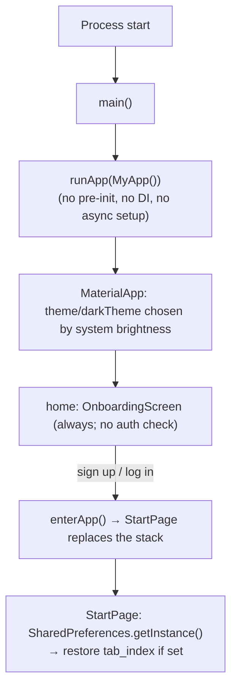

| Concern | Implementation |
|---|---|
| Initialization before `runApp()` | None |
| Dependency injection | None. Widgets construct what they need (`SharedPreferences.getInstance()`, `DeviceInfoPlugin()`, `getSampleTickets()`). |
| Authentication check / initial screen | None. The app always opens on `OnboardingScreen`, and no session is persisted. |
| Background / resume handling | None. There is no lifecycle observer. |
| Disposal | `TextEditingController`s (all auth screens), `AnimationController` (`AuthScaffold`) and `DraggableScrollableController` plus its listener (`TicketDetailPage`) are disposed in `dispose()`. No other disposable resources are created. |

---

## 12. Observed behaviour and open questions

These describe the current behaviour of the code as written. They're recorded so readers aren't surprised; this section doesn't propose changes.

1. **`TicketDetailPage` throws on non-iOS platforms.** `computeDisplayBorderRadius()` always calls `DeviceInfoPlugin().iosInfo`. On the Android emulator this caused an unhandled `type 'Null' is not a subtype of type 'String'` in `IosDeviceInfo.fromMap` (stack trace points at `ticket_detail.dart:301`). Re-checked on 2026-11-19 at `47757f2` with the same result. The exception is unhandled but not fatal: the page still renders. The method also runs on every `build`, and every successful call ends in `setState`, which triggers another `build`.
2. **The sort-label strings still don't all match each other.**
   - The native menu (iOS) sets `'By priority'`, `'Alphabetically'` and `'By project'`.
   - The Material fallback (Android) sets `'By priority'`, `'Alphabetical'` and `'by Project'`.
   - `TicketSorting.sortTickets` matches `'by Priority'`, `'Alphabetically'` and `'by Project'`.
   - The screen shows priority sections for `'By priority'` and project sections for `'By project'`.

   What happens as a result (Android rows checked on the emulator):

   | Platform | Option | Sorted? | Layout |
   |---|---|---|---|
   | iOS | By priority | No (no `sortTickets` case) | Priority sections ✔ |
   | iOS | Alphabetically | A→Z ✔ | Flat list |
   | iOS | By project | No | Project sections ✔ (InSync, SpendWise, Elevate: first-seen order) |
   | Android | Priority | No | Priority sections ✔ |
   | Android | Alphabetical | **No** ✘ | Flat list |
   | Android | Project | By project name ✔ | **Flat list** ✘ (not grouped, because `'by Project'` ≠ `'By project'`) |

   Since nothing produces `'by Priority'`, that `sortTickets` case never runs.
3. **The "Undetermined" section shows the Low tickets.** `groupByPriority` (`Sorting_Tickets.dart:41`) fills the `Priority.undetermined` bucket with `ticket.priority == Priority.low`. In the priority view, "Update documentation" appears twice (under Low and Undetermined), and the real undetermined ticket, "Review new feature", appears nowhere. Confirmed on the emulator.
4. **The calendar selection doesn't filter tickets.** `onSelect` only stores `_selectedCalIndex`.
5. **The `TicketDetailPage` fade-in relies on a later rebuild.** `opacity = 1` is set without `setState`. On iOS, the `setState` from `computeDisplayBorderRadius` happens to trigger a rebuild; on other platforms that call throws first. On the Android emulator, opening a ticket shows a plain black background with **no priority gradient**.
6. **Several controls have no behaviour yet:** the settings gear (`InSyncAppBar`), the ellipsis action (`TicketDetailPage`), "My Projects" rows, the iOS tab bar "New" action button (**Needs Further Investigation:** whether `LiquidGlassTabBar` reports it through `onTabSelected`), and the `organizationName` / `organizationCode` passed to `SignUpScreen`.
7. **Hard-coded display values:** "Assigned to" always shows the same `ProfileStack` of 9 images (4 placeholder avatars + 5 copies of the logo, so it reads "+5") whatever the ticket's `assignedTo` is; `ContributionCard` shows 83 tickets in 7 days; and the onboarding subtitle is lorem ipsum.
8. **The DEBUG menu is on by default** (`InSyncAppBar.debugProperties = true`) on Home and My Tickets.
9. **`test/widget_test.dart` is the default counter template.** It looks for `'0'` and an `Icons.add` button that don't exist in `MyApp`, so it doesn't reflect the current app.
10. **The "Due in Nd" tag shows one day less than the due date.** `getSampleTickets()` sets `dueDate = now + N days` and `TicketListItemBuilder` later computes `dueDate.difference(DateTime.now()).inDays`. By then a few milliseconds have passed, so the difference is just under N days, and `inDays` rounds it down to N − 1. On the emulator, the ticket due Sat, Nov 21 (two days out) shows "Due in 1d".
11. **Unused code:** `getTickets()` in `InSync_list.dart`, `ColorDodgeFilter`, `utils.dart`'s `WeekdayOptions.longhand` path (only `shorthand` is used; the file is now marked `// TODO: Delete`, but `CalendarCarousel` still imports `getWeekDay`), the `InSyncColors.*Priority` colours, and five declared packages (§9).
12. **`ProfileStack` needs at least 5 children.** It calls `children.sublist(0, 5)` unconditionally, so a list of fewer than 5 would throw a `RangeError`. The only caller passes 9.
13. **An import's capitalisation doesn't match the file name.** `home_screen.dart:4` imports `../widgets/Contribution_card.dart`, but the file was renamed to `contribution_card.dart`. It builds on Windows (and on default macOS volumes), whose file systems ignore case. **Needs Further Investigation:** a build on a case-sensitive file system (e.g. Linux CI) would most likely fail to find the file.
14. **Popup menus log `MissingPluginException` on Android.** Opening or closing the sort menu or the ⋮ DEBUG menu logs `No implementation found for method suppressGlassEffects / unsuppressGlassEffects on channel liquid-glass-lifecycle`, from `native_liquid_glass`'s lifecycle handling (the app registers `LiquidGlassNavigatorObserver` in `main.dart`). It's unhandled but harmless: the menu works. Pushing full pages (e.g. a ticket) doesn't log it.
