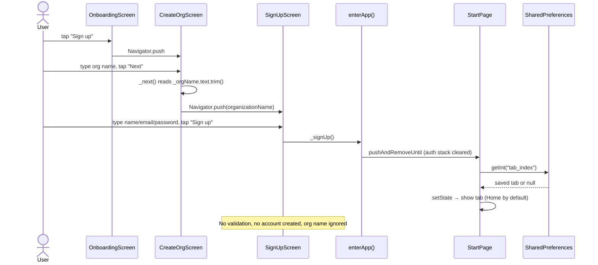
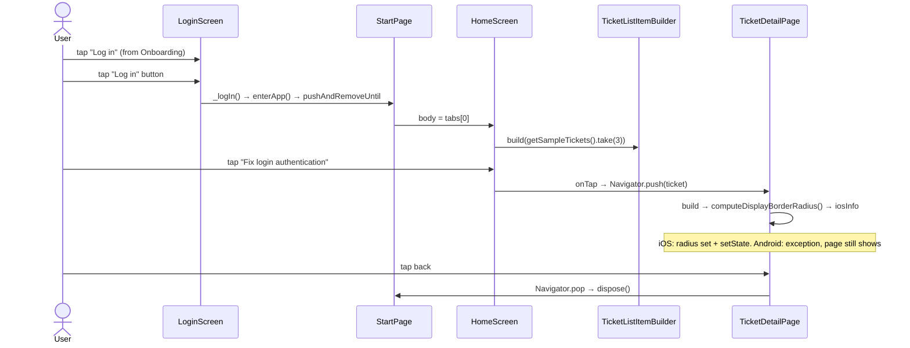
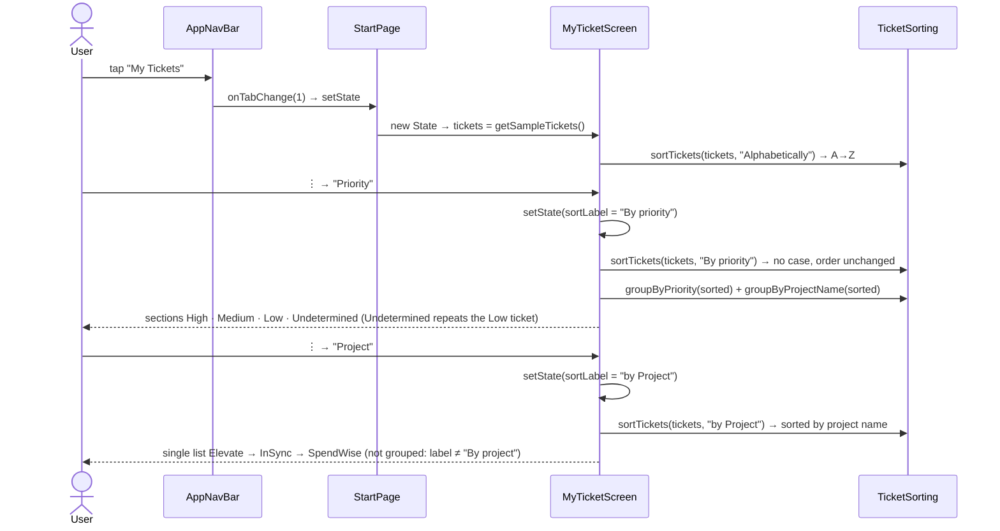

# InSync — User Actions Reference

> **What this is.** For every action a user can take in the app, this lists the code that runs, what it calls next, and what changes as a result. It's based on the code at commit `47757f2` and was checked on the Android emulator on 2026-11-19. Line numbers are 1-based. For architecture and background, see [`ARCHITECTURE.md`](ARCHITECTURE.md).
>
> **How to read a row.** *Action* → *Handler* (`file:line`) → *Calls* → *Result*. "Nothing" means the control exists but its handler is empty or missing.

There's no backend, so no action talks to a server. Everything happens in memory, except one `SharedPreferences` key, `tab_index`.

## Contents

1. [Auth flow (before login)](#1-auth-flow-before-login)
2. [Main app shell (tab bar)](#2-main-app-shell-tab-bar)
3. [Top app bar (Home and My Tickets)](#3-top-app-bar-home-and-my-tickets)
4. [Home tab](#4-home-tab)
5. [My Tickets tab](#5-my-tickets-tab)
6. [Search tab](#6-search-tab)
7. [Ticket detail page](#7-ticket-detail-page)
8. [Things that happen without a tap](#8-things-that-happen-without-a-tap)
9. [What each action changes (state summary)](#9-what-each-action-changes-state-summary)
10. [End-to-end journeys](#10-end-to-end-journeys)

---

## 1. Auth flow (before login)

All five auth screens are drawn by `AuthScaffold` (`lib/widgets/auth/auth_components.dart`), so the behaviours under "Any auth screen" apply to all of them.

### 1.1 Any auth screen

| User action | Handler | Calls | Result |
|---|---|---|---|
| Tap a text field | Flutter `TextField` focus | Keyboard opens, so `MediaQuery.viewInsets.bottom > 0` | `AuthScaffold.build` (`auth_components.dart:70`) sees `keyboardOpen = true`. The logo slides to the top and shrinks to 200 px or less (`:100-102`) with a 350 ms animation, and fades out if smaller than 40 px (`:121`). |
| Tap empty space (outside a field) | `GestureDetector.onTap` (`auth_components.dart:82`) | `FocusScope.of(context).unfocus()` | Keyboard closes, and the logo animates back to its large position. |
| Press keyboard **Next** on a field with `TextInputAction.next` and no `onSubmitted` | Flutter default | Moves focus to the next field | Cursor moves to the next field (Sign up: name → email → password; Log in: email → password). |
| Type in any field | `TextEditingController` | — | Text is stored in the screen's controller. No listener, validation or live check runs. |
| System back (Android) / swipe back (iOS) | `Navigator` default | `pop` | Returns to the previous auth screen. The popped screen's `dispose()` frees its controllers. |
| *(passive)* | `AnimationController _spin` (`:52-55`) | `repeat(reverse: true)` | The logo keeps rocking back and forth by 60°. |

### 1.2 Onboarding screen — `lib/screens/auth/onboarding_screen.dart`

| User action | Handler | Calls | Result |
|---|---|---|---|
| Tap **Sign up** | `AuthButton.onPressed` (`:26-28`) | `Navigator.push(CreateOrgScreen())` | Opens **Create an org**. |
| Tap **Log in** | `AuthButton.onPressed` (`:35-37`) | `Navigator.push(LoginScreen())` | Opens **Log in**. |

### 1.3 Create an org — `lib/screens/auth/create_org_screen.dart`

| User action | Handler | Calls | Result |
|---|---|---|---|
| Type an org name | `_orgName` controller (`:15`) | — | Stored only. |
| Press keyboard **Next** | `onSubmitted` (`:46`) | `_next()` (`:23`) | Same as tapping **Next**. |
| Tap **Next** | `AuthButton.onPressed` (`:49`) | `_next()` → `Navigator.push(SignUpScreen(organizationName: _orgName.text.trim()))` | Opens **Sign up** and passes the org name in. An empty name is allowed. |
| Tap **Join an org** | `AuthButton.onPressed` (`:54-56`) | `Navigator.pushReplacement(JoinOrgScreen())` | Swaps this screen for **Join your org**, so back goes to Onboarding, not here. |

### 1.4 Join your org — `lib/screens/auth/join_org_screen.dart`

| User action | Handler | Calls | Result |
|---|---|---|---|
| Type an org code | `_code` controller (`:15`) | — | Stored only. The `XXXX-XXXX-XXXX-XXXX` hint isn't enforced. |
| Press keyboard **Next** | `onSubmitted` (`:44`) | `_next()` (`:23`) | Same as tapping **Next**. |
| Tap **Next** | `AuthButton.onPressed` (`:47`) | `_next()` → `Navigator.push(SignUpScreen(organizationCode: _code.text.trim()))` | Opens **Sign up** and passes the code in. |
| Tap **Create an org** | `AuthButton.onPressed` (`:52-54`) | `Navigator.pushReplacement(CreateOrgScreen())` | Swaps this screen for **Create an org**. |

### 1.5 Sign up — `lib/screens/auth/sign_up_screen.dart`

| User action | Handler | Calls | Result |
|---|---|---|---|
| Type name / email / password | `_displayName`, `_email`, `_password` (`:20-22`) | — | Stored only. **Never read.** |
| Press keyboard **Done** on password | `onSubmitted` (`:62`) | `_signUp()` (`:33`) | Same as tapping **Sign up**. |
| Tap **Sign up** | `AuthButton.onPressed` (`:65`) | `_signUp()` → `enterApp(context)` (`auth_navigation.dart:6`) → `Navigator.pushAndRemoveUntil(StartPage(), (_) => false)` | Opens the main app and **clears the whole auth stack**, so back can't return to sign up. No account is created. The received `organizationName` / `organizationCode` are ignored. (`// TODO` at `:32`) |

### 1.6 Log in — `lib/screens/auth/login_screen.dart`

| User action | Handler | Calls | Result |
|---|---|---|---|
| Type email / password | `_email`, `_password` (`:14-15`) | — | Stored only. **Never read.** |
| Press keyboard **Done** on password | `onSubmitted` (`:47`) | `_logIn()` (`:25`) | Same as tapping **Log in**. |
| Tap **Log in** | `AuthButton.onPressed` (`:50`) | `_logIn()` → `enterApp(context)` → `pushAndRemoveUntil(StartPage(), …)` | Opens the main app and clears the auth stack. Any input, including empty fields, works. (`// TODO` at `:24`) |

What `enterApp` sets off when it builds `StartPage` is described in [§8](#8-things-that-happen-without-a-tap).

---

## 2. Main app shell (tab bar)

`lib/screens/start_page.dart` + `lib/widgets/common/bottom_nav_bar.dart`. On iOS 27+ the bar is a native `LiquidGlassTabBar`. Everywhere else, Android included, it's a Material `NavigationBar`.

| User action | Handler | Calls | Result |
|---|---|---|---|
| Tap **Home** / **My Tickets** (Android: "My Tickets", iOS: "Ticket") / **Search** | Material: `onDestinationSelected` (`bottom_nav_bar.dart:69`). iOS: `onTabSelected` (`:52`) | `onTabChange(index)` → `setState(() => _selectedIndex = index)` (`start_page.dart:55-59`) | The body becomes `tabs[index]`. The old tab's widget is **disposed** and the new one is **rebuilt from scratch**; there's no `IndexedStack`. Scroll position is lost. My Tickets re-runs `getSampleTickets()`, and the app bar re-reads `SharedPreferences`. |
| Tap the iOS **New** (+) button | `iosActionButton` (`bottom_nav_bar.dart:56`) | No handler is attached | Nothing visible. **Needs Further Investigation:** whether `LiquidGlassTabBar` reports it through `onTabSelected` (for example as index 3, which would go past the end of `tabs`). |
| System back (Android) | `Navigator` | `StartPage` is the only route | Leaves the app. It doesn't return to login. |

`_selectedIndex` is a **file-level global** (`start_page.dart:8`), so the chosen tab is remembered in memory but not saved to disk.

---

## 3. Top app bar (Home and My Tickets)

`InSyncAppBar` in `lib/widgets/common/app_bar.dart`. The DEBUG menu is shown because `debugProperties` defaults to `true` (`:9`).

| User action | Handler | Calls | Result |
|---|---|---|---|
| Tap the **settings gear** | `onPressed: () {}` (`:64` iOS, `:68` Android) | — | **Nothing.** |
| **Android:** tap ⋮ → **Sample Ticket** | `PopupMenuItem.onTap` (`:138-147`) | `Navigator.push(TicketDetailPage(ticket: getSampleTickets()[0]))` | Opens the detail page for "Fix login authentication". |
| **iOS:** tap 🐞 → **Show sample ticket** | `onItemSelected('sample_ticket')` (`:110-118`) | Same push as above | Same as above. |
| **iOS:** tap 🐞 → **Default tab bar index** → Home / My Tickets / Search | `onItemSelected('tab_index_N')` (`:119-125`) | `prefs.setInt("tab_index", N)` + `setState(selectedTabIndex = N)` | Saves the chosen tab to disk and moves the checkmark in the menu. The **current tab doesn't change**. The app opens on tab N the next time `StartPage` is created, which is after the next log in or sign up, including after an app restart. This option doesn't exist on Android. |
| Back arrow | `automaticallyImplyLeading: showBackButton` (`:52`) | — | Not shown in practice, even though My Tickets passes `showBackButton: true`. `StartPage` is the root route, so there's nothing to go back to (confirmed on emulator). |

---

## 4. Home tab

`lib/screens/home_screen.dart`

| User action | Handler | Calls | Result |
|---|---|---|---|
| Tap a **Priority Tickets** row | `InkResponse.onTap` in `InSyncList` (`InSync_list.dart:64/95/120/140`, depending on the row's position) → `InSyncListItem.onTap` set in `TicketListItemBuilder.build` (`ticket_Builder.dart:49-51`) | `Navigator.push(TicketDetailPage(ticket: ticket))` | Sparkle ripple, then that ticket's detail page opens. See [§7](#7-ticket-detail-page). |
| Tap a **My Projects** row (Dog / Cat / Chicken Feeding) | No `onTap` (`home_screen.dart:53-82`) | — | **Nothing**, and no ripple, because rows without `onTap` aren't wrapped in `InkResponse`. The chevron is decorative. |
| Tap the **Contribution card** ("Closed 83…") | No handler | — | Nothing. The values are hard-coded (`:30-31`). |
| Scroll | `ListView` | — | Scrolls. The list goes under the transparent app bar and tab bar (`extendBodyBehindAppBar`, `extendBody`). |

Home shows the **first 3** tickets from `getSampleTickets()` (`:41`), in list order rather than sorted by priority.

---

## 5. My Tickets tab

`lib/screens/my_ticket_screen.dart`

### 5.1 Calendar strip — `lib/widgets/calendar_carousel.dart`

| User action | Handler | Calls | Result |
|---|---|---|---|
| Tap a **day** that isn't selected | `_CalendarCarouselPiece.onTap` → closure (`calendar_carousel.dart:55-65`) | `widget.selectedIndex = index` → `onSelect(index, date)` → `_selectedCalIndex = index` (`my_ticket_screen.dart:112-114`) → carousel `setState` | That day turns orange (`primaryContainer`). The **ticket list doesn't change**, because the date isn't used for filtering. `MyTicketScreen` doesn't call its own `setState`. |
| Tap the **selected day** again | Same closure, `if` branch (`:56-58`) | `widget.selectedIndex = -1` → `onDeselect` (not provided, so nothing runs) → `setState` | The highlight is removed. The global `_selectedCalIndex` keeps the **old** value, so after switching tabs and coming back, the old day is highlighted again. |
| Swipe horizontally | `CustomScrollView` | `SliverList.builder` builds days on demand | Scrolls through an endless list of days starting today. A red bar with the month name marks the 1st of each month (or the year on 1 January). |

### 5.2 Sort menu

The "Sorted …" label next to the menu shows `sortLabel.toLowerCase()` (`:138`). `sortLabel` is a **file-level global** (`:24`) that starts as `'Alphabetically'`, so the choice survives tab switches.

Every rebuild runs `TicketSorting.sortTickets(tickets, sortLabel)` (`Sorting_Tickets.dart:5`), then both `groupByPriority` (`:33`) and `groupByProjectName` (`:45`). Then (`my_ticket_screen.dart:155-186`):
- `sortLabel == 'By priority'` → one `BuildSection` per non-empty High / Medium / Low / Undetermined group
- `sortLabel == 'By project'` → one `BuildSection` per project
- anything else → one flat `InSyncList`

**Android (Material `PopupMenuButton`, `:73-93`):** tap ⋮ → pick an option → `onSelected` → `setState(sortLabel = value)` → rebuild as above. All three rows were checked on the emulator.

| Option tapped | `sortLabel` becomes | `sortTickets` behaviour | Layout | What the user sees |
|---|---|---|---|---|
| Priority | `'By priority'` | No matching case, so no sorting | **Sections:** High, Medium, Low, Undetermined | Grouped ✔, but the Undetermined section repeats the Low ticket ("Update documentation"), and "Review new feature" is missing ✘ |
| Alphabetical | `'Alphabetical'` | **No matching case** | Single list | Original order, **not alphabetical** ✘. The label reads "Sorted alphabetical". |
| Project | `'by Project'` | Sorts by project name | **Single list** (the screen checks for `'By project'`) | Sorted Elevate → InSync → SpendWise, but **not grouped** ✘. The label reads "Sorted by project". |

The default `'Alphabetically'` (before anything is picked) **does** sort A→Z.

**iOS (native `CNPopupMenuButton`, `:32-71`):** pick an option → `onSelected(id)` → `setState` with `sortLabel` set from the item index.

| Option tapped | `sortLabel` becomes | `sortTickets` behaviour | Layout | What the user sees |
|---|---|---|---|---|
| By priority | `'By priority'` | No matching case | **Sections:** High, Medium, Low, Undetermined | Same as Android "Priority": grouped, with the Undetermined bug ✘ |
| Alphabetically | `'Alphabetically'` | A→Z by title | Single list | Sorted ✔ |
| By project | `'By project'` | No matching case | **Sections**, one per project, in first-seen order (InSync, SpendWise, Elevate) | Grouped by project ✔ |

On iOS the menu icon becomes filled whenever the sort isn't `'Alphabetically'` (`:36-38`).

**Android only:** opening or closing the menu logs a harmless `MissingPluginException` (`liquid-glass-lifecycle` channel). See `ARCHITECTURE.md` §12.14.

### 5.3 Ticket list

| User action | Handler | Calls | Result |
|---|---|---|---|
| Tap a **ticket row** (flat list or grouped section) | Same as Home: `InSyncList` → `TicketListItemBuilder` `onTap` | `Navigator.push(TicketDetailPage(ticket: ticket))` | Opens the detail page. |
| Scroll | Outer `ListView` | — | Scrolls the calendar and list together. A 100 px spacer at the end (`:191`) keeps the last row above the tab bar. |

---

## 6. Search tab

`lib/screens/placeholder_page.dart` shows a hammer icon and "Page is under construction". **It has nothing interactive.**

---

## 7. Ticket detail page

`lib/screens/ticket_detail.dart`. It opens from a ticket row (Home or My Tickets) or from the DEBUG "sample ticket" item.

### 7.1 What happens when the page opens

| Step | Code | Result |
|---|---|---|
| 1 | `initState` (`:34-40`): `_drawerController.addListener(...)` | A listener is attached to a controller that's never used, because the bottom sheet is commented out. |
| 2 | `initState`: `Future.delayed(1 µs, () => opacity = 1)` | Sets `opacity` **without `setState`**, so it only takes effect if something else triggers a rebuild. |
| 3 | `build` (`:57`): `computeDisplayBorderRadius()` (`:296`) | Runs `DeviceInfoPlugin().iosInfo`. **iOS:** sets `radius` (6 / 56 / 61) from the model name, then calls `setState`. That rebuild shows the priority gradient, and **calls this method again on every build**. **Android:** throws `type 'Null' is not a subtype of type 'String'` (unhandled but not fatal). The page renders **without** the gradient. |
| 4 | `build` | Shows the title, project, due date, "Assigned by", "Assigned to", the description, and last modified. "Assigned to" is a `ProfileStack` (`:159-170`) of the same 9 hard-coded images for every ticket: 4 avatars plus a "+5" bubble. |

### 7.2 Actions on the page

| User action | Handler | Calls | Result |
|---|---|---|---|
| Tap **back** (‹) | `onPressed` (`:94`, both platforms) | `Navigator.pop(context)` | Returns to the previous tab. `dispose()` (`:49-53`) removes the listener and disposes the controller. |
| System back / swipe | `Navigator` default | `pop` | Same as above. |
| Tap **⋯** | `onPressed: () {}` (`:98`, `:100`) | — | **Nothing.** |
| Tap the **project row** | No `onTap` (`:123-138`) |
| Tap the **avatars** in "Assigned to" | No handler | — | **Nothing.** | — | **Nothing.** The chevron is decorative. |

---

## 8. Things that happen without a tap

These run automatically as a side effect of an action above.

| Trigger | Code | Calls | Result |
|---|---|---|---|
| App launch | `main()` → `runApp(MyApp())` (`main.dart:6-8`) | `MaterialApp(home: OnboardingScreen)` | Always opens on Onboarding. There's no saved session. |
| Device light/dark mode changes | `MaterialApp` (`themeMode` defaults to system) | Picks `theme` or `darkTheme` | The main app recolours. The auth screens don't, because they always draw their own gradient. |
| `StartPage` is created (after Sign up / Log in) | Constructor (`start_page.dart:15-19`) | `SharedPreferences.getInstance()` → `getInt("tab_index")` | If saved, the global `_selectedIndex` is overwritten. |
| `StartPage` state starts | `initState` (`:28-35`) | Reads `tab_index` again → `setState` | Opens on the saved tab, or Home if nothing is saved, or whichever tab was last used in memory. |
| Any screen with `InSyncAppBar` is built | `InSyncAppBarState.initState` (`app_bar.dart:36-43`) | Reads `tab_index` → `setState(selectedTabIndex)` | Positions the checkmark in the iOS DEBUG menu. |
| My Tickets tab is built | `_MyTicketScreenState.tickets` (`my_ticket_screen.dart:28`) | `getSampleTickets()` | Makes six new sample tickets, each time the tab is opened. |
| Every My Tickets rebuild | `build` (`:99-104`) | `sortTickets` + `groupByPriority` + `groupByProjectName` | The list is re-sorted and regrouped from `sortLabel`. |
| Each ticket row is built | `TicketListItemBuilder.build` (`ticket_Builder.dart:31`) | `dueDate.difference(DateTime.now()).inDays` | Shows "Due in Nd", which comes out one day short (see `ARCHITECTURE.md` §12.10). |

---

## 9. What each action changes (state summary)

| State | Where it lives | Changed by | Survives tab switch? | Survives app restart? |
|---|---|---|---|---|
| Current tab | global `_selectedIndex` (`start_page.dart:8`) | Tapping a tab; `tab_index` on `StartPage` creation | Yes | No (but see `tab_index`) |
| Default tab | `SharedPreferences` `tab_index` | iOS DEBUG → Default tab bar index | — | **Yes** |
| Sort choice | global `sortLabel` (`my_ticket_screen.dart:24`) | Sort menu | Yes | No |
| Selected calendar day | global `_selectedCalIndex` (`:25`) + `CalendarCarousel.selectedIndex` | Tapping a day (but not deselecting it) | Yes | No |
| Form text | Each auth screen's `TextEditingController` | Typing | n/a (freed on pop) | No |
| Navigation stack | `Navigator` | push / pushReplacement / pushAndRemoveUntil / pop | — | No |

No action creates, edits, completes or deletes a ticket. The ticket data is read-only sample data.

---

## 10. End-to-end journeys

### 10.1 New user creates an org and signs up

### 10.2 Returning user logs in and opens a ticket

### 10.3 Sorting tickets on My Tickets (Android)

